

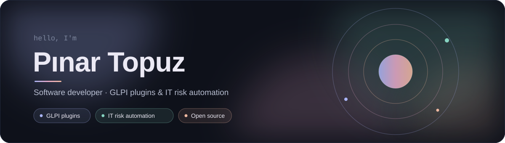

 

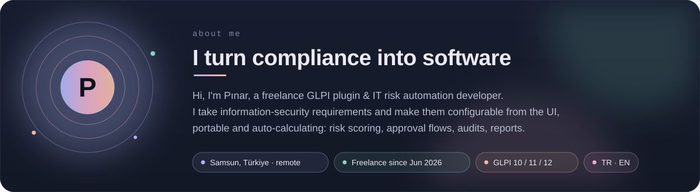

 

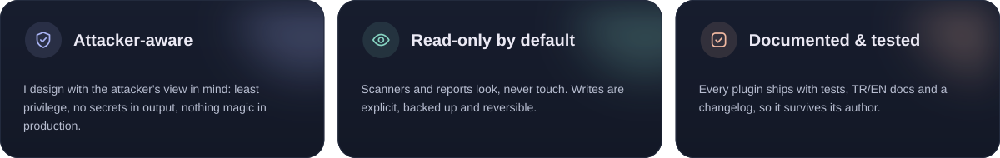

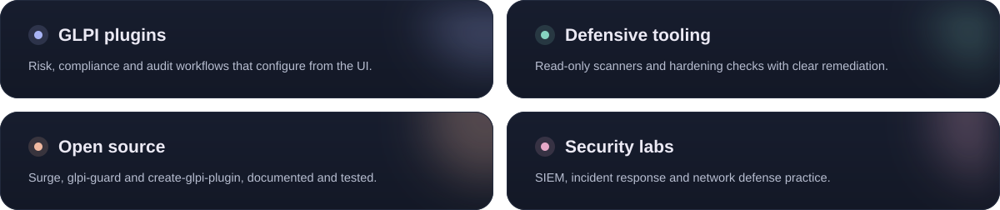

<a href="https://github.com/CodeByPinar/glpi-surge">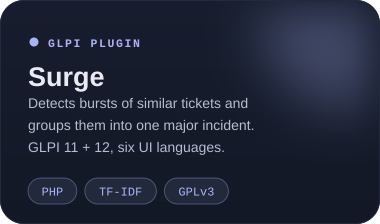</a>
<a href="https://github.com/CodeByPinar/glpi-guard">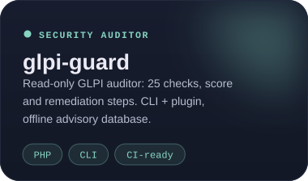</a>
<a href="https://github.com/CodeByPinar/glpi-plugin-cli">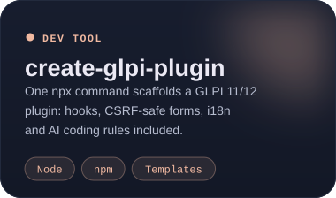</a>

 


 


 


 


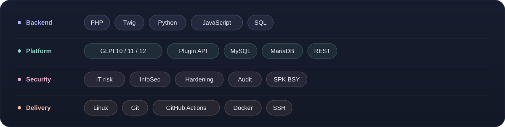

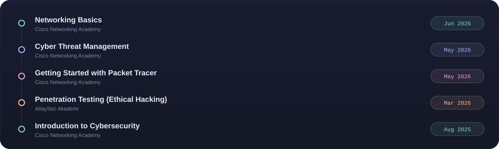

 

  

